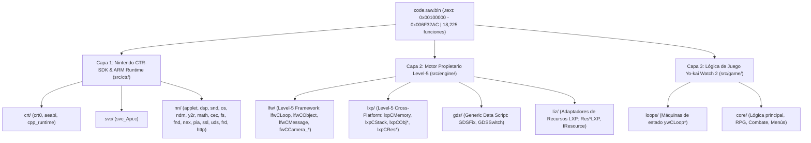

# Organización Modular del Proyecto — Yo-kai Watch 2: Psychic Specters (3DS)

Este documento describe la estructura arquitectónica del repositorio tras la consolidación de funciones sueltas (`func_*.c`) en **unidades de traducción canónicas (`.cpp` / `.c`)** basadas exclusivamente en los módulos reales del **Nintendo 3DS CTR-SDK (`nn::*`)** y en los descriptores **RTTI / literales del motor de Level-5 (`lfw*`, `lxp*`, `gds*`, `liz*`)** presentes en el binario de *Yo-kai Watch 2*.

---

## 1. Visión General de las 3 Capas Arquitectónicas

El ejecutable principal (`code.raw.bin`, segmento `.text` en `0x00100000`–`0x006F32AC`, `6,238,892` bytes y `18,225` funciones) se divide en **3 capas** y **233 unidades de código** verificadas en [`build/report.json`](build/report.json) y [`objdiff.json`](objdiff.json):

| Capa | Directorio Fuente | Cabeceras | Funciones Totales | Funciones Matched (C/C++) | Estrategia de Organización |
| :--- | :--- | :--- | :---: | :---: | :--- |
| **Capa 1 (`ctr`)** | [`src/ctr/`](src/ctr/) | [`include/ctr/`](include/ctr/), [`include/nn/`](include/nn/) | 3,658 | **122** | Modularizada por subsistema oficial del Nintendo 3DS CTR-SDK (`nn::*`) |
| **Capa 2 (`engine`)** | [`src/engine/`](src/engine/) | [`include/engine/`](include/engine/) | 6,593 | **12** | Modularizada por clases C++ reales extraídas de RTTI (`lfw*`, `lxp*`, `gds*`, `liz*`) |
| **Capa 3 (`game`)** | [`src/game/`](src/game/) | [`include/game/`](include/game/) | 7,974 | **30** | Mantenida con `src/game/loops/ywCLoop*.cpp` y `src/game/core/` |

> [!IMPORTANT]
> **Cero archivos `func_*.c` sueltos en `src/ctr/` y `src/engine/`:** Todas las funciones decompiladas de las Capas 1 y 2 residen ahora dentro de su unidad `.cpp` o `.c` definitiva, compiladas con `--split_sections` en ARMCC RVCT 4.0/4.1 para respetar los literal pools individuales sin regresiones.

---

## 2. Capa 1: Nintendo CTR-SDK & ARM Runtime (`src/ctr/`)

Organizada según la jerarquía oficial del Nintendo 3DS CTR-SDK (`nn::*`) verificada contra las cadenas IPC, cabeceras de comando TLS y tablas DDL de `code.raw.bin`:

### 2.1 Unidades Activas en Disco (`src/ctr/` e `include/nn/`)

| Subsistema | Unidad de Compilación | Cabecera Asociada | Rango VMA | Progreso (Funciones) | Progreso (Bytes) |
| :--- | :--- | :--- | :---: | :---: | :---: |
| **`crt`** | [`clear_bss.s`](src/ctr/crt/clear_bss.s) (`crt0.c`) | — | `0x00100000`–`0x001001FF` | 1 stub ASM | 40 B |
| **`nn::svc`** | [`svc_Api.c`](src/ctr/svc/svc_Api.c) | [`svc.h`](include/ctr/svc.h) | `0x00104778`–`0x005F015C` | **25 / 71 (35.21%)** | `528 / 8,244 B` (6.40%) |
| **`nn::os`** | [`os_Api.cpp`](src/ctr/nn/os/os_Api.cpp) | [`os_Api.h`](include/nn/os/os_Api.h), [`os.h`](include/ctr/os.h) | `0x00104780`–`0x0012788C` | **9 / 37 (24.32%)** | `140 / 7,992 B` (1.75%) |
| **`nn::y2r`** | [`y2r_Y2r.cpp`](src/ctr/nn/y2r/y2r_Y2r.cpp) | [`y2r_Y2r.h`](include/nn/y2r/CTR/y2r_Y2r.h) | `0x001128F8`–`0x001136FC` | **5 / 21 (23.81%)** | `176 / 3,276 B` (5.37%) |
| **`nn::y2r`** | [`detail_Api.cpp`](src/ctr/nn/y2r/detail_Api.cpp) | [`detail_Api.h`](include/nn/y2r/CTR/detail/detail_Api.h) | `0x00113700`–`0x00113F80` | **7 / 15 (46.67%)** | `196 / 2,316 B` (8.46%) |
| **`nn::ndm`** | [`ndm_Api.cpp`](src/ctr/nn/ndm/ndm_Api.cpp) | [`ndm_Api.h`](include/nn/ndm/ndm_Api.h) | `0x00127EE0`–`0x001280A8` | **3 / 3 (100.00%)** | `48 / 48 B` (100.00%) |
| **`nn::applet`** | [`applet.cpp`](src/ctr/nn/applet/applet.cpp) | [`applet.h`](include/ctr/applet.h) | `0x001284E4`–`0x0012864C` | **17 / 17 (100.00%)** | `312 / 312 B` (100.00%) |
| **`nn::snd`** | [`snd_Dspsnd.cpp`](src/ctr/nn/snd/snd_Dspsnd.cpp) | [`snd_Dspsnd.h`](include/nn/snd/CTR/snd_Dspsnd.h) | `0x00136154`–`0x001387B0` | **17 / 51 (33.33%)** | `536 / 7,508 B` (7.14%) |
| **`nn::dsp`** | [`CTR_Api.cpp`](src/ctr/nn/dsp/CTR_Api.cpp) | [`CTR_Api.h`](include/nn/dsp/CTR/CTR_Api.h) | `0x00136780`–`0x00138DFE` | **16 / 27 (59.26%)** | `472 / 1,732 B` (27.25%) |
| **`nn::dsp`** | [`dsp_DSP.cpp`](src/ctr/nn/dsp/dsp_DSP.cpp) | [`dsp_DSP.h`](include/nn/dsp/CTR/dsp_DSP.h) | `0x001384E8`–`0x00138C30` | **10 / 16 (62.50%)** | `528 / 1,756 B` (30.07%) |
| **`nn::nex`** | [`nex_RootObject.cpp`](src/ctr/nn/nex/nex_RootObject.cpp) | [`nex.h`](include/ctr/nex.h) | `0x00301000`–`0x00301800` | **1 / 16 (6.25%)** | `4 / 2,316 B` (0.17%) |
| **`nn::nex`** | [`qResult.cpp`](src/ctr/nn/nex/qResult.cpp) | [`nex.h`](include/ctr/nex.h) | `0x0031E800`–`0x0031F400` | **4 / 41 (9.76%)** | `56 / 2,820 B` (1.99%) |
| **`nn::nex`** | [`NexElement.cpp`](src/ctr/nn/nex/NexElement.cpp) | [`nex.h`](include/ctr/nex.h) | `0x00340000`–`0x00340D50` | **5 / 5 (100.00%)** | `72 / 72 B` (100.00%) |
| **`nn::nex`** | [`StationConnectionInfo.cpp`](src/ctr/nn/nex/StationConnectionInfo.cpp) | [`nex.h`](include/ctr/nex.h) | `0x00340D50`–`0x00341200` | **3 / 3 (100.00%)** | `52 / 52 B` (100.00%) |

### 2.2 Subdivisión Modular del Resto de CTR-SDK (`0x00100000`–`0x00370000`)
[`tools/generate_report.py`](tools/generate_report.py) clasifica todas las funciones pendientes del SDK según la evidencia real en `code.raw.bin`:
- **Runtime (`src/ctr/crt/`):** `crt0.c`, `aeabi_memcpy.c`, `aeabi_arith.c`, `cpp_runtime.cpp`, `cpp_exception.cpp`.
- **Sistema Operativo (`src/ctr/nn/os/`):** `os_Api.cpp`, `os_Thread.cpp`, `os_MemoryBlock.cpp`, `os_CriticalSection.cpp`, `MPCore_Api.cpp`, `os_EventBase.cpp`, `os_LightEvent.cpp`, `os_WaitObject.cpp`.
- **Matemáticas (`src/ctr/nn/math/`):** `math_ARMv6Asm.cpp`, `math_MTX44.cpp`.
- **Servicios IPC y Utilidades (`0x0028014C`–`0x002FFFFC`):** `fnd/fnd_ExpHeapBase.cpp`, `fnd/fnd_FrameHeapBase.cpp`, `gxlow/gxlow_Gpu.cpp`, `hid/hid_Api.cpp`, `cfg/cfg_Api.cpp`, `ac/ac_Api.cpp` (`0x002B915C`: `ac:u`), `am/am_Api.cpp` (`0x002B9A0C`: `am:app`), `aoc/aoc_Api.cpp` (`0x002B9D90`: `nim:aoc`), `ec/ec_Api.cpp` (`0x002BC620`: `sys.ECardStatus`), `fs/fs_Api.cpp` y `fs/fs_FileStream.cpp` (`0x002BEF7C`: comandos IPC `0x0801..0x0854`), `cec/CTR_Api.cpp`, `cec/cec_CecControl.cpp`, `cec/cec_Message.cpp`, `cec/cec_MessageBox.cpp` (`0x002C3D38`: `cecd:u`), y `zlib/inflate.c` + `deflate.c` (`0x002ED030`: `1.2.5`).
- **`nn::nex` (`src/ctr/nn/nex/`, `0x002DD000`–`0x00328400`):** Servicios y protocolos verificados en las tablas DDL de `.data` (`0x0082D38E`–`0x0083E805`): `nex_HealthService.cpp`, `nex_MonitoringProtocol.cpp`, `nex_MessagingService.cpp`, `nex_AccountManagementService.cpp`, `nex_AccountManagementProtocol.cpp`, `nex_TicketGrantingProtocol.cpp`, `nex_SecureConnectionService.cpp`, `nex_MatchMakingService.cpp`, `nex_NotificationProtocol.cpp`, `nex_RootObject.cpp`, `nex_NgsFacade.cpp`, etc.
- **`nn::pia` (`src/ctr/nn/pia/`, `0x00329400`–`0x00366000`):** Librería P2P/local *Platform Independent Architecture* de Nintendo dividida en sus 5 sub-espacios de nombres reales (`pia inet heap`, `pia local heap`, `pia common heap`, `pia session heap`, `pia transport heap`):
  - `pia/inet/`: `pia_NatDetecter.cpp`, `pia_NatTraverser.cpp`, `pia_NatDetectionJob.cpp`, `pia_NatPortDetecter.cpp`, `pia_SocketOutputStream.cpp`, `pia_NatPropertyDetecter.cpp`, `pia_NexConnectStationJob.cpp`, `pia_NexNatTraversalProtocol.cpp`, `pia_NatServerAddressResolveJob.cpp`, `pia_InetProcessHostMigrationJob.cpp`, `pia_NexFacade.cpp`.
  - `pia/local/`: `pia_UdsNodeBase.cpp`, `pia_UdsMigrationManager.cpp`, `pia_LocalProcessHostMigrationJob.cpp`, `pia_UdsNode.cpp`.
  - `pia/common/`: `pia_NetworkFactory.cpp`, `pia_BackgroundScheduler.cpp`.
  - `pia/session/`: `pia_JoinSessionJob.cpp`, `pia_LeaveSessionJob.cpp`, `pia_SessionProtocolReliable.cpp`, `pia_CreateSessionJob.cpp`, `pia_KickoutManageJob.cpp`, `pia_DestroySessionJob.cpp`, `pia_RelayRouteManageJob.cpp`, `pia_SessionClockProtocol.cpp`, `pia_ProcessJoinRequestJob.cpp`, `pia_ProcessHostMigrationJob.cpp`, `pia_ProcessUpdateSessionJob.cpp`, `pia_ProcessDestroySessionJob.cpp`, `pia_Session.cpp`.
  - `pia/transport/`: `pia_RttProtocol.cpp`, `pia_PacketAnalyzer.cpp`, `pia_LatencyEmulator.cpp`, `pia_SendThreadStream.cpp`, `pia_ConnectStationJob.cpp`, `pia_RelayRouteManager.cpp`, `pia_TransportAnalyzer.cpp`, `pia_ConnectionAnalyzer.cpp`, `pia_UnreliableProtocol.cpp`, `pia_ReceiveThreadStream.cpp`, `pia_DisconnectStationJob.cpp`, `pia_ReliableSlidingWindow.cpp`, `pia_StationProtocolManager.cpp`, `pia_PacketParser.cpp`, `pia_StationProtocolReliable.cpp`, `pia_ProcessConnectionRequestJob.cpp`, `pia_ThreadStreamManager.cpp`.
- **Servicios de Red Finales (`0x00366000`–`0x00370000`):** `ssl/ssl_Api.cpp` (`ssl:C`), `uds/uds_Api.cpp` (`nwm::UDS`), `frd/frd_Api.cpp` (IPC `0x0001..0x0035`, `0x0415..0x0417`), `http/http_Api.cpp` (`http:C`).

---

## 3. Capa 2: Motor Propietario de Level-5 (`src/engine/`)

Dado que el enlazador `armlink` ordena las secciones `.text` lexicográficamente por su símbolo C++ mangled (`_ZN10lxp...` a `_ZN18lxp...` en `0x00201A50`–`0x0028014C`, `_ZN3liz...` a `_ZN9lfw...` en `0x005E5588`–`0x00625000`, y los métodos `const` `_ZNK10lxp...` a `_ZNK9lfw...` en `0x00625008`–`0x0067684C`), cada rango se asigna exactamente a su clase RTTI real:

### 3.1 Unidades Activas en Disco (`src/engine/`)

| Submódulo | Unidad de Compilación | Cabecera Asociada | Rango VMA | Progreso (Funciones) | Progreso (Bytes) |
| :--- | :--- | :--- | :---: | :---: | :---: |
| **`lfw`** | [`lfwCLoopEmpty.cpp`](src/engine/lfw/lfwCLoopEmpty.cpp) | [`lfw.h`](include/engine/lfw.h) | `0x0010B6D0`–`0x0010B6E4` | **2 / 3 (66.67%)** | `20 / 300 B` (6.67%) |
| **`lfw`** | [`lfwCLoop.cpp`](src/engine/lfw/lfwCLoop.cpp) | [`lfw.h`](include/engine/lfw.h) | `0x0010B544`–`0x00674590` | **5 / 127 (3.94%)** | `112 / 19,200 B` (0.58%) |
| **`lxp`** | [`lxpCMemory.cpp`](src/engine/lxp/lxpCMemory.cpp) | [`lxp.h`](include/engine/lxp.h) | `0x0012CB00`–`0x00131500` | **4 / 69 (5.80%)** | `40 / 15,880 B` (0.25%) |
| **`core`** | [`lfwCObjManager.cpp`](src/engine/core/lfwCObjManager.cpp) | [`core.h`](include/engine/core.h) | `0x0013C000`–`0x0013F800` | **1 / 46 (2.17%)** | `12 / 14,192 B` (0.08%) |

### 3.2 Clases RTTI y Gestores Reales del Motor (`lfw`, `lxp`, `gds`, `liz`)
- **`src/engine/lfw/`:** `lfwCLoopEmpty.cpp`, `lfwCLoop.cpp`, `lfwCObject.cpp`, `lfwCMessage.cpp`, `lfwCObjLine.cpp`, `lfwCObjImage.cpp`, `lfwCObj2D.cpp`, `lfwCObj3D.cpp`, `lfwCObj2DManager.cpp`, `lfwCObj3DManager.cpp`, `lfwCCameraManager.cpp`, `lfwCCamera_Dev.cpp`, `lfwCCamera_Fix.cpp`, `lfwCCamera_Mtn.cpp`, `lfwCCamera_Move.cpp`, `lfwCCamera_Dolly.cpp`, `lfwCCamera_Orbit.cpp`.
- **`src/engine/lxp/`:** `lxpCStack.cpp`, `lxpCMemory.cpp`, `lxpCMemObj.cpp`, `lxpCDrwRes.cpp`, `lxpCResource.cpp`, `lxpCResourceBase.cpp`, `lxpCResourceManagerBase.cpp`, `lxpCResourceManagerRef.cpp`, `lxpCOpenGLES.cpp`, `lxpCBGProcess.cpp`, `lxpCBGLoadManager.cpp`, `lxpCBGBuildManager.cpp`, `lxpCCamera.cpp`, `lxpCCameraMotion.cpp`, `lxpCCameraControl.cpp`, `lxpCMessage.cpp`, `lxpCObjAnime.cpp`, `lxpCObjChara.cpp`, `lxpCObjCharaMerge.cpp`, `lxpCObjSimpleModel.cpp`, `lxpCObjColor.cpp`, `lxpCObjImage.cpp`, `lxpCObjImage2.cpp`, `lxpCObjCanvas.cpp`, `lxpCObjMovie.cpp`, `lxpCObjBlur.cpp`, `lxpCObjDOF.cpp`, `lxpCObjEasyDOF.cpp`, `lxpCObjCapture.cpp`, `lxpCObjLocus.cpp`, `lxpCObjLocus1.cpp`, `lxpCObjLocus2.cpp`, `lxpCObjParticle.cpp`, `lxpCResAnime.cpp`, `lxpCResChara.cpp`, `lxpCResModel.cpp`, `lxpCResParticle.cpp`, `lxpCSkyManager.cpp`, `lxpCFontManager.cpp`, `lxpCAnimeManager.cpp`, `lxpCCharaManager.cpp`, `lxpCImageManager.cpp`, `lxpCLightManager.cpp`, `lxpCModelManager.cpp`, `lxpCMovieManager.cpp`, `lxpCParticleManager.cpp`, `lxpCLoop.cpp`, `CLcs1.cpp`, `CLcs2.cpp`.
- **`src/engine/gds/`:** `GDSFix.cpp`, `GDSSwitch.cpp`.
- **`src/engine/liz/`:** `ResBaseLXP.cpp`, `ResAnimeLXP.cpp`, `ResCharaLXP.cpp`, `ResImageLXP.cpp`, `ResModelLXP.cpp`, `ResObj2DLXP.cpp`, `ResSkyLXP.cpp`, `IResource.cpp`.

---

## 4. Capa 3: Lógica de Juego Yo-kai Watch 2 (`src/game/`)

Tal y como se definió, la capa del juego conserva su estructura actual:
- **`src/game/loops/`:** Cada estado derivado de `lfwCLoop` tiene su propio `.cpp` (`ywCLoopMain.cpp`, `ywCLoopRPG.cpp`, `ywCLoopBattle.cpp`, `ywCLoopMenu.cpp`, `ywCLoopRace.cpp`, `ywCLoopEvent.cpp`, `ywCLoopCapsule.cpp`, `ywCLoopOrgeTime.cpp`, `ywCLoopWatchmap.cpp`, `ywCLoopYokaispot.cpp`, `ywCLoopQR.cpp`), junto a las funciones base de bucles en `ywCLoop.cpp`.
- **`src/game/core/`:** Contiene las funciones específicas de mecánicas del juego.

---

## 5. Flujo de Trabajo y Comandos de Verificación

1. **Añadir una nueva función decompilada en `ctr` o `engine`:**
   - En lugar de crear un archivo `func_XXXXXXXX.c` aislado, se añade directamente dentro del `.cpp` / `.c` de su unidad correspondiente (que puedes consultar en `build/report.json` o ejecutando `assign_target_unit` en [`tools/generate_report.py`](tools/generate_report.py)).
   - Gracias al flag `--split_sections` en [`Makefile`](Makefile), ARMCC genera una sección ELF independiente (`i.<symbol>`) con su propio literal pool para cada función del `.cpp`, evitando colisiones de desplazamientos PC-relative.
2. **Comandos de validación:**
   - `make check`: Compila todas las unidades y verifica el matching 100% byte-exact e instrucciones/reubicaciones contra `extracted/code.raw.bin`.
   - `make progress`: Regenera los objetos `expected/*.o`, actualiza `README.md`, `objdiff.json` y el overlay `live.json` / `live.txt`.
   - `make report`: Genera `build/report.json` con las **233 unidades** listas para visualizar el porcentaje exacto de avance en `objdiff` o `decomp.dev`.
